<div align="center">


# ObserverLauncher

**Desktop launcher and server manager for Minecraft on Windows and Linux.**  
Create Java or Rust servers on your own PC, invite friends without touching router settings, inspect players in 3D, and explore your world map right from the app.

[](https://github.com/Kag4286/ObserverLauncher/releases/latest)
[](https://github.com/Kag4286/ObserverLauncher/releases)
[](https://github.com/Kag4286/ObserverLauncher/actions/workflows/test.yml)
[](LICENSE)
[](https://github.com/Kag4286/ObserverLauncher/releases/latest)

[Releases](https://github.com/Kag4286/ObserverLauncher/releases/latest) · [Release Notes](docs/release-9.1.0.md) · [Changelog](CHANGELOG.md) · [Contributing](CONTRIBUTING.md) · [Architecture](docs/architecture.md)

<br>

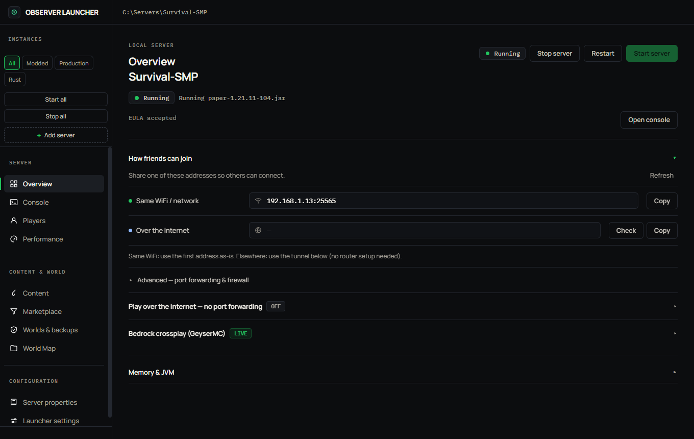

</div>

---

## What It Is For

If you just want to host a Minecraft world on your Windows or Linux PC for friends, or quickly spin up a test server for a modpack, ObserverLauncher keeps everything in one desktop window. You do not need an account, a cloud subscription, Docker, or a separate web panel, and your worlds never leave your computer.

## Getting Started

1. Download the Windows installer (`.exe`) or Linux package (`.AppImage`) from [Releases](https://github.com/Kag4286/ObserverLauncher/releases/latest).
2. On first launch, pick your language and choose between **Beginner** (keeps only the essentials visible) or **Advanced** (shows every tool).
3. Click **Create new server**, pick a folder, choose a built-in preset (`survival-5`, `creative-build`, `modded-performance`), a custom saved template, or pick your server software (Vanilla, Paper, Purpur, Leaf, Folia, Fabric, Forge, NeoForge, Spigot via BuildTools, Velocity, Pumpkin, or Horizon) and Minecraft version.
4. Click **Start**. If Java is missing or the wrong version for that server, ObserverLauncher downloads a SHA-256-verified portable Adoptium OpenJDK build (Java 8, 17, 21, or 25) automatically. Native Rust servers like Pumpkin and Horizon run without Java at all.
5. Play over local Wi-Fi using your LAN address, or turn on the built-in Playit.gg or Pinggy tunnel so friends can join over the internet without router port forwarding.

<div align="center">
  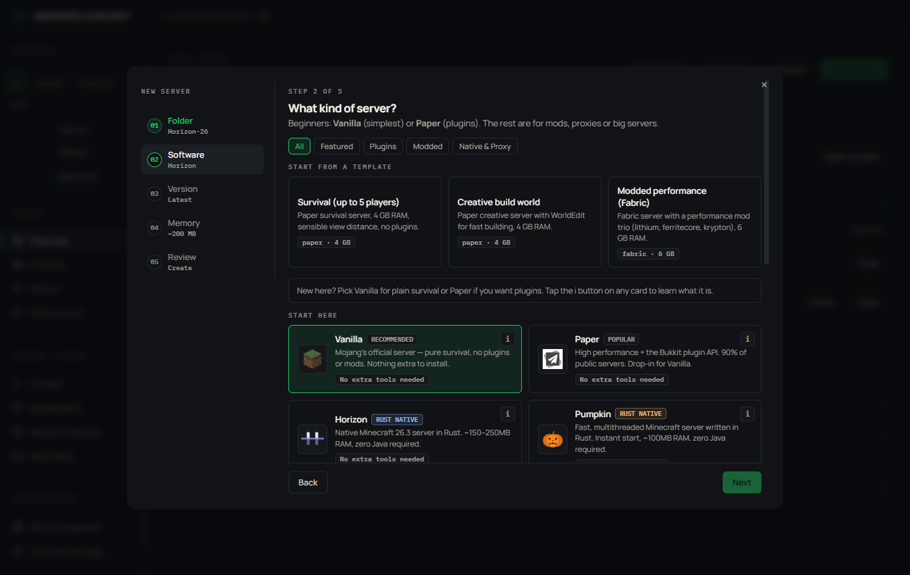
</div>

---

## Features for Players and Server Hosts

### Live Console, Server Doctor & Performance Telemetry
- Filter live console logs (`INF`, `WRN`, `ERR`, `CMD`), search output, click any player name in the log to jump straight to their inspector, or export logs.
- Monitor real-time **TPS**, **MSPT**, **CPU**, and **RAM** charts backed by a persistent **3-tier telemetry store** (`10s` raw samples for 24 hours, `1m` rollups for 7 days, and `1h` rollups for 30 days in `dataDir/metrics/*.jsonl`) with memory-leak and tick-drop diagnostics.
- Open **Server Doctor** straight from Overview to scan port conflicts, RAM pressure/leaks, crash loops, and missing mod dependencies, then apply individual **Suggest + Confirm** repairs (`change_port`, `install_dependency`, `tune_performance`, `restore_backup`).
- When a server crashes, **Crash Doctor** reads the log and explains common causes such as wrong Java versions, missing dependencies, Mixin conflicts, or out-of-memory errors.

<p align="center">
  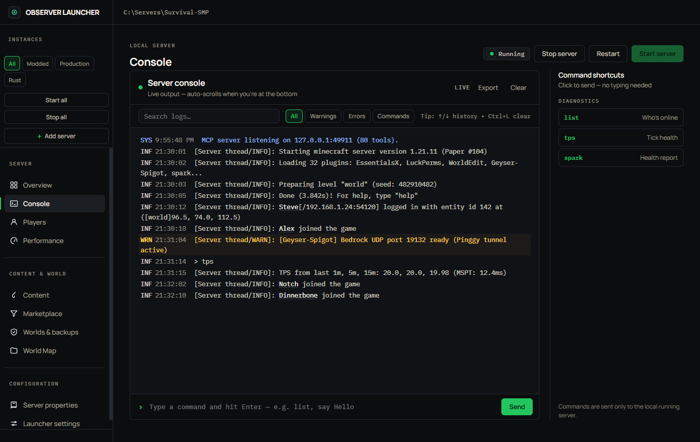
  &nbsp;
  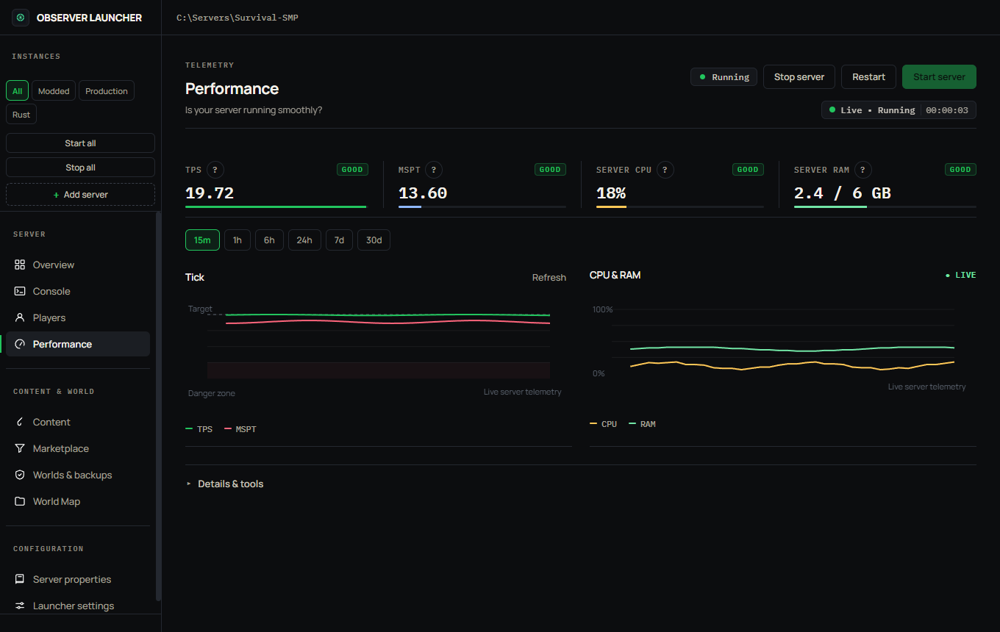
</p>

### Beginner Mode & Personalization
New hosts can keep **Beginner mode** turned on to hide advanced tabs and Java memory sliders, leaving just **Overview**, **Console**, **Players**, **Server properties**, and **Launcher settings**. While running, Overview shows a simple **"Your server is running!"** box where you can switch between your Wi-Fi address and your internet tunnel in one click. You can toggle between Beginner and Advanced anytime in **Launcher settings > Personal**.

Personal settings also include 7 UI languages (`en`, `vi`, `es`, `pt-BR`, `de`, `ru`, `zh-CN`), a **Lite animation mode** for older PCs, per-server accent colors and icons in the sidebar, and **Custom Resource Pack (`.zip`)** support so 3D player armor and inventory icons match your resource pack.

### Multi-Server Management, Templates, Upgrades & Sharing
- Run multiple servers in separate folders, tag them into sidebar groups, and use **sequenced Start-All / Stop-All** bulk instance controls from the rail.
- Save any configured server as a **custom reusable template** (`templates.json`), pick from built-in presets (`survival-5`, `creative-build`, `modded-performance`), manage custom templates directly inside the wizard, and install recommended template plugins/mods right after creation.
- **Guided Minecraft Version Upgrade Assistant**: preflight Java compatibility and plugin/mod availability for a target Minecraft version, create an automatic pre-upgrade backup, transactionally archive the old server JAR (restored if the download fails), batch-update compatible content, and optionally disable incompatible JARs before first boot.
- **Startup Orphan Process Reconnect / Stop Prompt**: if the launcher closes or crashes while a server is still running, it detects the orphaned process on launch and lets you reconnect via RCON or stop it safely without losing uptime.
- Built-in **Playit.gg** (Java TCP) and **Pinggy** (Bedrock UDP) tunnels let friends join without opening router ports.
- If **Geyser** or **Floodgate** is installed for Bedrock crossplay (phones and consoles), the launcher checks your config for common port and auth mistakes and can fix them in one click with a backup.
- Support for both standard Java servers (including **Spigot BuildTools** compilation) and native Rust engines (**Pumpkin** and **Horizon**, typically using ~100 to 250 MB RAM with no Java required).

### Mods, Plugins, Modpacks, Datapacks & Configs
- Browse and manage large servers comfortably with **25 items per page** pagination across plugins, mods, and datapacks, plus instant filtering and enable/disable toggles.
- Search and install plugins, mods, datapacks, and modpacks directly from **Modrinth** (and **CurseForge** when you add your own API key in settings) with **SHA-256 / SHA-1 supply-chain hash verification**.
- **Automatic Content-Update Stability Rollback**: batch-update plugins and mods with automatic backups in `observerlauncher-content-backups/`, a **120-second stability timer** (`stability.json`) that automatically rolls back updates if the server crashes shortly after updating, plus manual one-click revert.
- Detect duplicate mods, loader mismatches, client-only JARs, and missing dependencies before startup — and install missing dependencies with a **1-click confirmed Install button** straight from the conflict banner.
- Import or export Modrinth `.mrpack` bundles (including headless export with automatic credential/secret stripping and blocked-executable protection on import).
- **Datapack ZIP Validator, One-Click Extractor & Load-Order Editor**: validate `pack.mcmeta` `pack_format` against your server's Minecraft version, safely extract `.zip` datapacks into folders, and reorder `DataPacks.Enabled` in `level.dat` atomically with backups.
- Edit plugin configs in the built-in folder tree editor (with external-edit **mtime conflict guard**), tweak `server.properties` with **rolling 20-snapshot history, LCS line diffs, and one-click restore**, or manage backend routes in `velocity.toml` for Velocity proxies.

<p align="center">
  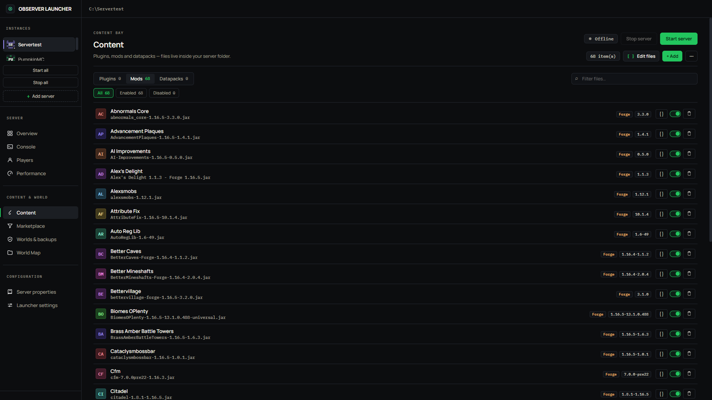
  &nbsp;
  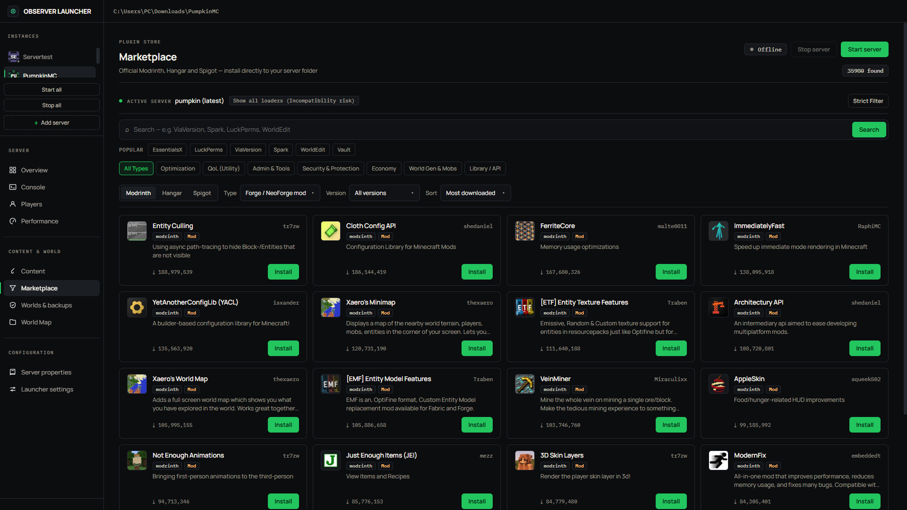
</p>

### Worlds, Backups, Schedules & Notifications
- Create manual world ZIP backups or turn on **Auto-backup** (`15m`, `30m`, `1h`, or a custom interval) with automatic retention pruning of old auto-backups (flushes `save-off` / `save-all` / `save-on` over stdin or RCON).
- **Safe World Operations**: rename worlds, inspect or set seeds in `level.dat`, **clone worlds** within the same server or across registered instances (skipping `session.lock`), **reset Nether (`DIM-1` / `_nether`) or End (`DIM1` / `_the_end`)** with automatic backups, and edit gamerules offline.
- Enable **Auto-restart on crash** (with retry limits and delay) and configure daily/weekly **Start, Stop & Restart schedules** with **in-game countdown broadcast warnings** (`5m`, `1m`, `30s`, `10s`, skippable when 0 players are online), **custom daily automation rules** (scheduled backups or console commands), and persistent fire-state tracking (`scheduler-state.json`).
- Send **Discord Rich Embeds** (or compact/generic JSON) when the server starts, stops, crashes, backs up, drops TPS, opens a tunnel, or when players join and leave, and display a live **"Playing" status (Discord Rich Presence)** in a dedicated **Discord** settings tab (hidden in Beginner mode).

<p align="center">
  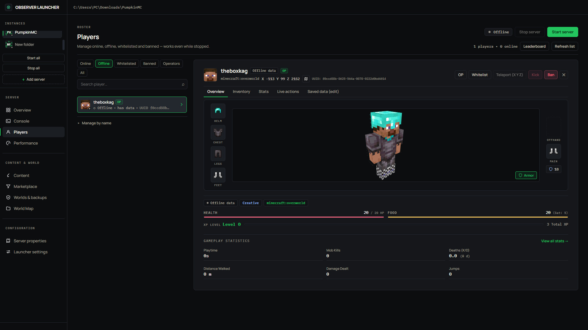
  &nbsp;
  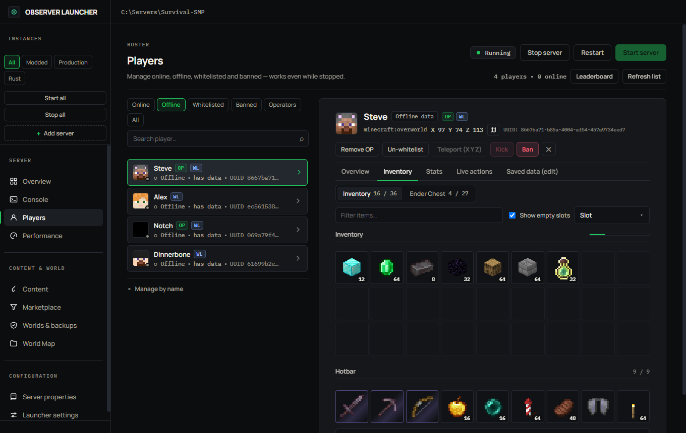
</p>

### Player Inspector 2.0 & Analytics
- View each player in interactive 3D with their Mojang skin, outer skin layers, and equipped armor (including modded armor sets when textures exist in installed mods) — plus **SkinsRestorer offline-mode skin integration** (reads `plugins/SkinsRestorer` `.player` and `.playerskin` records so offline/cracked servers render real skins).
- **Server Player Analytics & Leaderboards**: aggregates playtime, deaths, mob/player kills, and blocks mined across `<world>/stats/` and Minecraft 1.21.5+/26.x `<world>/players/stats/` across worlds.
- Inspect players while they are online even if they have not saved a `.dat` file yet, which works smoothly on first joins and native Rust servers.
- Browse the 9x4 inventory and Ender Chest grid with item search, sorting, enchantments, and colored tooltips.
- When the server is stopped, edit saved health, hunger, XP, gamemode, or clear inventory (a backup is kept automatically). While live, run `/op`, `/whitelist`, `/tp`, `/kick`, or `/ban` straight from the toolbar.

<div align="center">
  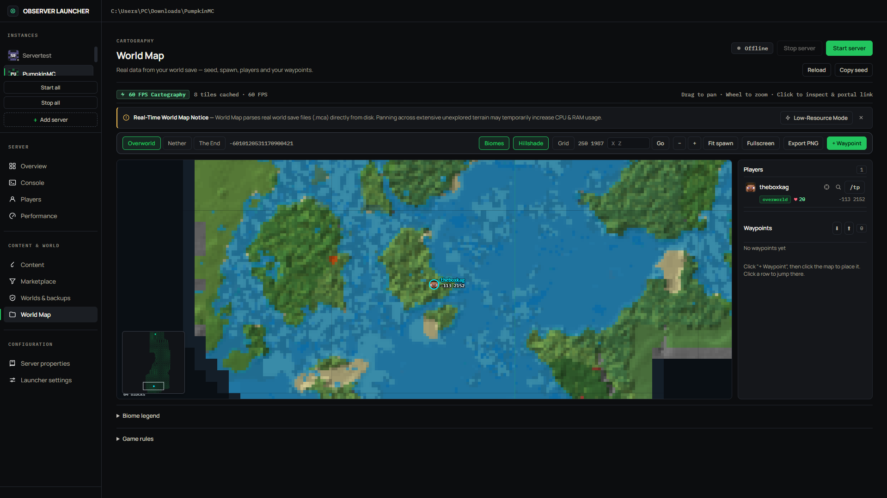
</div>

### World Map, Waypoints & Cartography
- Explore your world directly from saved `.mca` region files without installing Dynmap or BlueMap: see biomes, terrain relief, surface blocks, water, structures (across legacy 1.12–1.17 and modern 1.18–1.21.11 / 26.x saves), and a 1:8 Overworld/Nether portal coordinate converter.
- Turn on **Low-Resource Mode** on the map for lighter CPU/RAM usage, toggle **Cheat Mode** in settings to keep survival exploration fair by default, import/export **Xaero's Minimap** and **JourneyMap** waypoints, and click players or markers to `/tp`.

---

## Supported Server Software

| Software | Runtime | Ecosystem | Telemetry |
|---|---|---|---|
| **Paper / Purpur / Leaf / Folia** | Java 17 to 25 | Bukkit, Spigot, Paper plugins | Live TPS, MSPT, heap memory |
| **Fabric / Quilt** | Java 8 to 25 | Fabric mods | Player metrics, process telemetry |
| **Forge / NeoForge** | Java 8 to 25 | Forge & NeoForge mods | Live TPS, mod dependency checks |
| **Spigot / CraftBukkit** | Java 8 to 25 (via BuildTools) | Bukkit plugins | Heap memory, player list |
| **Vanilla** | Java 8 to 25 | Official Mojang server | Player list, console stream |
| **Velocity** | Java 17 to 25 | Multi-server proxy | Proxy routes, connection status |
| **Pumpkin** | Rust Native | Vanilla protocol clean-room | Process RAM/CPU, console TPS & MSPT |
| **Horizon** | Rust Native | MC 26.3 clean-room | Process RAM/CPU, `server.toml` sync |

---

## Power-User & Developer Interfaces

All backend modules run without an Electron window (`src/headless.js`), enabling CLI control, remote dashboards, container export, metrics scraping, and local MCP automation.

### Headless CLI (`observer`)

```bash
observer status                                 # Active server status, jar, and Java runtime
observer init --template survival-5             # Scaffold a server from a built-in or saved template
observer set-folder /path/to/server             # Point an instance at a server directory
observer start --instance survival              # Start a specific server instance (also: stop, restart)
observer logs --lines 200                       # Print recent server logs
observer metrics                                # Print live CPU, RAM, TPS, and MSPT metrics
observer cmd "say Hello!"                       # Send a console command
observer players                                # List online, whitelisted, op, and banned players (alias: player list)
observer install <mod-or-plugin>                # Install from Modrinth/marketplace (alias: mod install)
observer backup                                 # Create a ZIP backup (alias: world backup)
observer templates                              # List built-in and user-saved templates
observer doctor                                 # Run crash, console, and performance diagnostics
observer modpack verify modpack.json --strict   # CI verification (--server, --offline, --strict)
observer modpack build modpack.json             # Transactional modpack assembly into server folder
observer docker create --type paper             # Generate Dockerfile and docker-compose.yml
```

Run `observer --help` for full command flags (`--json`, `--instance <id>`, `--server`, `--offline`, `--strict`).

### Remote Web Dashboard & HTTP API
Enabled under **Launcher settings > Integrations** (off by default):
- Serves an in-memory web dashboard at `/` (`/ui`) with live SSE streaming, protected by constant-time Bearer token auth, brute-force lockout (`15 fails / 5m`), rate limiting (`300/min`), Origin/Host checks (with optional `remoteAllowedHosts` for reverse proxies), and IP/CIDR allowlisting.
- Endpoints: `GET /health`, `GET /events` (SSE), `GET /instances`, `GET /status`, `GET /metrics`, `GET /backups`, `GET /console`, `GET /players`, plus `POST /action` (`start`, `stop`, `force_stop`, `restart`, `kick`, `backup`, `whitelist_add`, `whitelist_remove`, `ban`, `unban`) and `POST /command` (disabled when **Read-only** is enabled).
- Binds to `127.0.0.1` by default for safe tunneling over Tailscale; see [docs/remote.md](docs/remote.md).

### Docker Export & Prometheus Metrics
- **Docker Export** (**Settings > Advanced**): generates `Dockerfile`, `docker-compose.yml`, `.dockerignore`, and `README.docker.md` configured for either OpenJDK or slim native Rust binaries (`./server` and `./data` mounts with healthcheck).
- **Prometheus Metrics**: optional loopback-only (`127.0.0.1`) `/metrics` endpoint for Grafana scraping.

### Local MCP Server & MCP Apps
ObserverLauncher exposes 80 server-management tools via `src/mcp/bridge.js` (stdio bridge forwarding to a per-launch authenticated loopback HTTP RPC server):
- **Safety tiers & audit log**: tools are grouped into `read` (always allowed), `write` (prompts in-app unless **Auto-allow write tools** is enabled), and `destroy` (always requires explicit GUI confirmation, disabled in **Read-only mode**). All calls are logged to a rotating JSONL audit log (`mcp-audit.log`, 3-file rotation), and file reads pass through `maskSecrets()` to redact RCON passwords and tokens.
- **MCP Apps Interactive Dashboard (`ui://observerlauncher/dashboard`, SEP-1865)**: renders live canvas metrics charts, health-check rows, and player chips directly inside MCP hosts supporting MCP Apps.
- **10 Built-in MCP Workflow Prompts**: `diagnose_server`, `optimize_for_ram`, `explain_last_crash`, `set_up_paper_for_players`, `audit_mods`, `safe_modpack_install`, `recover_corrupted_world`, `update_minecraft_version`, `setup_geyser_bedrock`, and `design_modpack`.
- **10 Static + 6 Templated MCP Resources**: exposes live server state, logs, metrics, crash reports, and the curated mod-stack reference (`observer://guides/mod-stacks`).
- **1-Confirm Batch Modpack Planning & Autonomous Doctor**: `plan_modpack` / `assemble_modpack` resolve recursive dependencies and install full stacks in one confirmed batch, while `propose_fix` / `apply_fix` plan and execute verified server repairs.

<p align="center">
  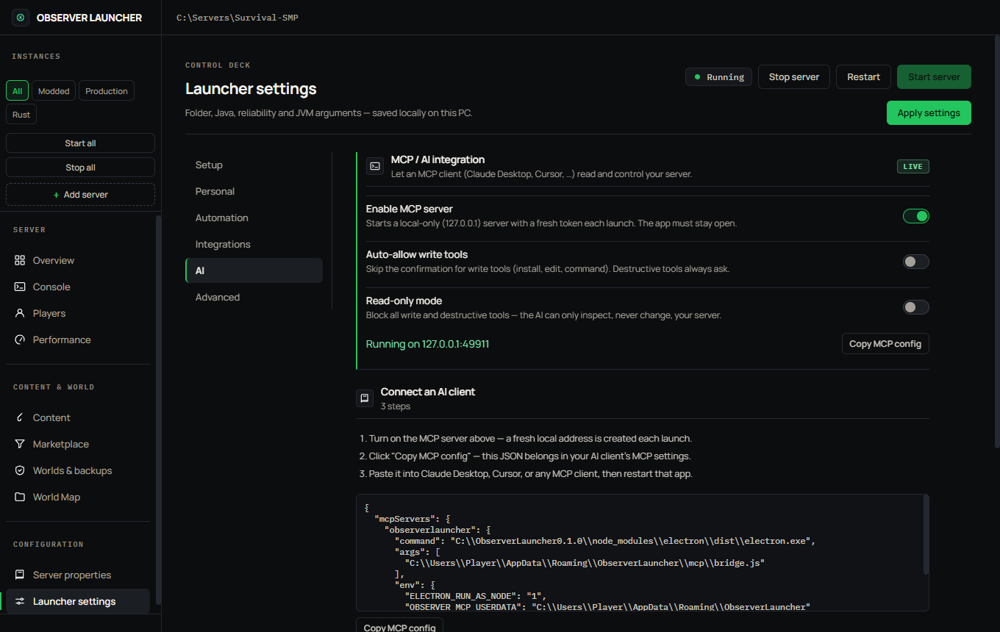
  &nbsp;
  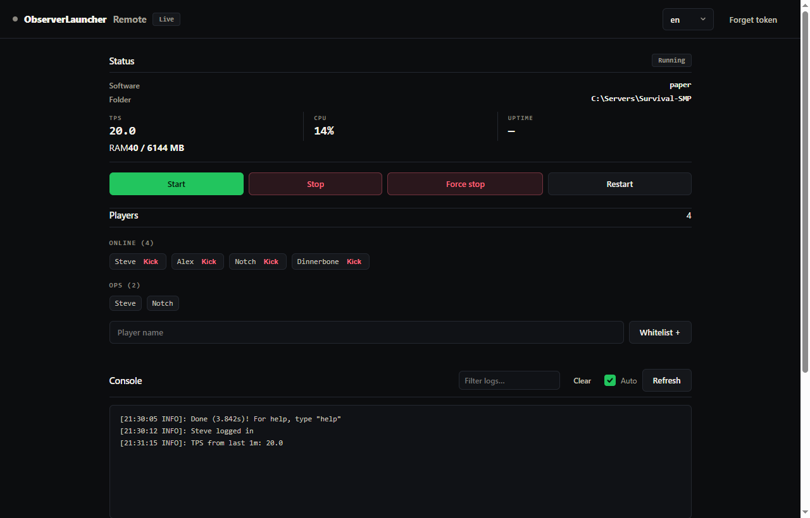
</p>

---

## Scope & Limitations

- **Desktop platforms only:** Prebuilt packages target Windows 10/11 (64-bit) and Linux `x86_64` (`.AppImage`). There is no macOS build yet.
- **Built for local PCs, not 24/7 VPS clusters:** Designed for hosting on a personal machine or testing modpacks locally. For multi-node Linux servers running 24/7 in Docker or Proxmox, use a dedicated web panel such as Crafty Controller or Pterodactyl.
- **Native Rust engines are upstream WIP:** Pumpkin and Horizon compatibility depends on upstream server progress; Bukkit/Paper plugins relying on JVM internals may not behave identically to Paper.

## System Requirements

- **OS:** Windows 10/11 (64-bit) or Linux (`x86_64`, glibc 2.31+)
- **CPU:** 64-bit dual-core minimum (quad-core recommended for modded servers)
- **RAM:** 4 GB minimum (8 GB+ recommended for modded Java servers)
- **Disk:** ~1 GB for launcher files and Java runtimes, plus space for worlds and backups
- **Java:** Optional (auto-downloaded if missing for Java servers; not required for Pumpkin or Horizon)

## Building from Source

The codebase uses Electron and plain Node.js without a bundler (`src/` runs directly). NBT, Anvil `.mca` region parsing, LZ4 scheme-4 decompression, and ZIP inspection are implemented in JavaScript.

```bash
git clone https://github.com/Kag4286/ObserverLauncher.git
cd ObserverLauncher

npm install
npm start          # Launch Electron app in development mode
npm test           # Run unit and integration suite (193 test files)
npm run test:e2e   # Run Playwright Electron E2E tests

npm run build:win   # Windows installer (.exe)
npm run build:linux # Linux AppImage
```

## Security & Privacy

- **Zero telemetry:** Network requests happen only for server/mod/Java downloads, Mojang skin lookups, and user-enabled tunnels or webhooks.
- **Renderer isolation:** Windows run with `contextIsolation: true` and `nodeIntegration: false`, communicating strictly through `src/preload.js`.
- **Filesystem boundaries & archive safety:** File reads, writes, and archive extractions validate canonical paths (`safeTarget`) to block path traversal and Zip-Slip. `.mrpack` imports block executable scripts, `.mrpack` exports strip sensitive credentials, skin downloads verify PNG headers with a 512 KB cap, and POSIX `settings.json` is written with `0o600` permissions.
- **SSRF & DNS-rebinding filtering:** Download URLs and webhooks resolve hostnames (`assertPublicHost`) before connecting to reject loopback, link-local, metadata endpoints, and private subnets.
- **Fail-closed MCP & Remote RPC:** Loopback-only MCP RPC enforces bearer-token authentication with brute-force lockout and `jvmArgs` validation; Adoptium JREs and marketplace packages undergo SHA-256 / SHA-1 checksum verification.

## License

Licensed under [Apache-2.0](LICENSE).  
Minecraft is a trademark of Mojang Synergies AB. ObserverLauncher is an independent open-source project and is not affiliated with Mojang or Microsoft.
