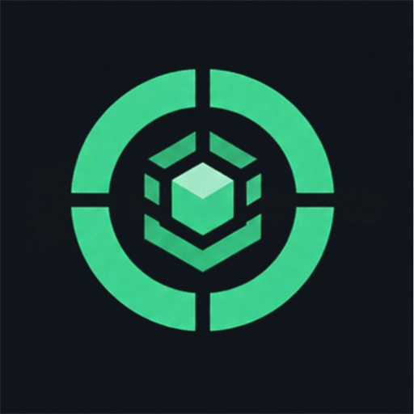
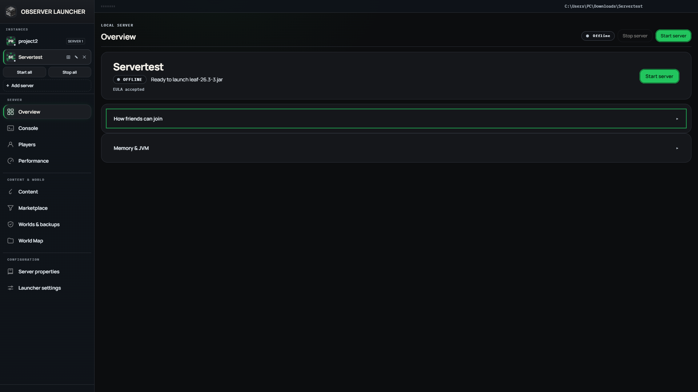
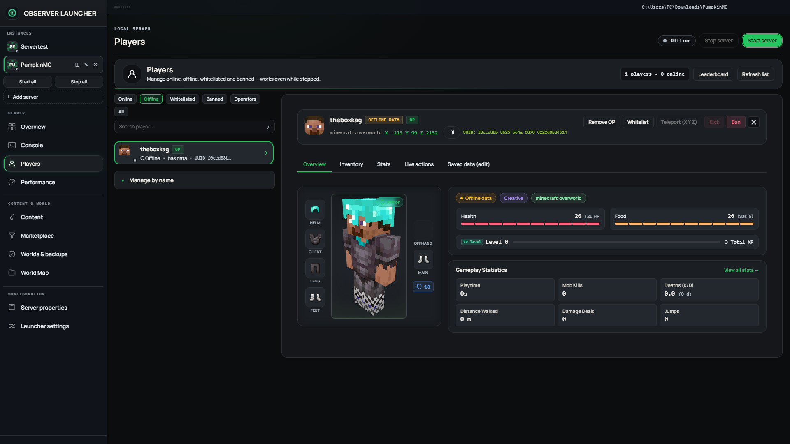
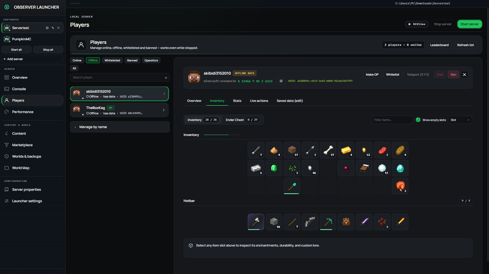
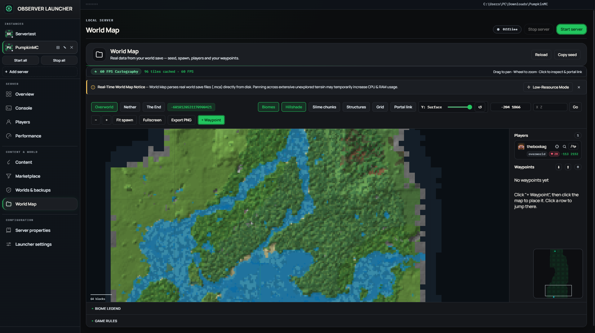
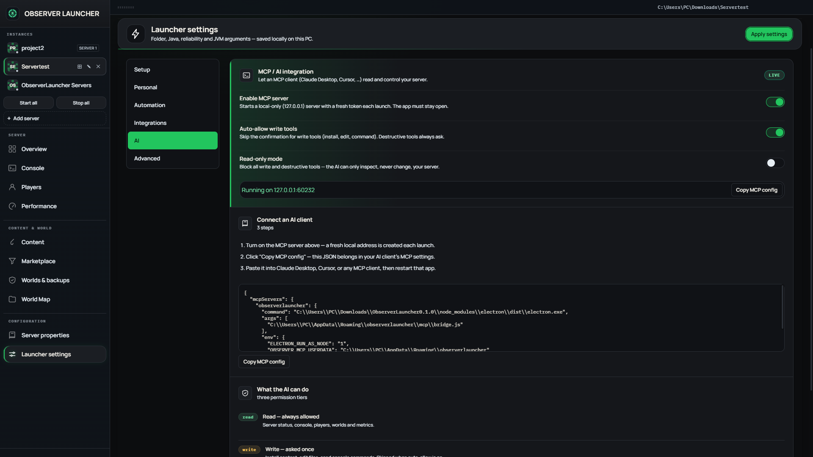

<div align="center">



# ObserverLauncher

**Desktop launcher and server manager for Minecraft on Windows and Linux.**  
Create Java or Rust servers on your own PC, invite friends without touching router settings, inspect players in 3D, and explore your world map right from the app.

[](https://github.com/Kag4286/ObserverLauncher/releases/latest)
[](https://github.com/Kag4286/ObserverLauncher/releases)
[](https://github.com/Kag4286/ObserverLauncher/actions/workflows/test.yml)
[](LICENSE)
[](https://github.com/Kag4286/ObserverLauncher/releases/latest)

[Releases](https://github.com/Kag4286/ObserverLauncher/releases/latest) · [Release Notes](release.md) · [Changelog](CHANGELOG.md) · [Contributing](CONTRIBUTING.md) · [Architecture](docs/architecture.md)

<br>



</div>

---

## What It Is For

If you just want to host a Minecraft world on your Windows or Linux PC for friends, or quickly spin up a test server for a modpack, ObserverLauncher keeps everything in one desktop window. You do not need an account, a cloud subscription, Docker, or a separate web panel, and your worlds never leave your computer.

## Getting Started

1. Download the Windows installer (`.exe`) or Linux package (`.AppImage`) from [Releases](https://github.com/Kag4286/ObserverLauncher/releases/latest).
2. On first launch, pick your language and choose between **Beginner** (keeps only the essentials visible) or **Advanced** (shows every tool).
3. Click **Create new server**, pick a folder, choose your server software (Vanilla, Paper, Fabric, Forge, Pumpkin, and more), and pick a Minecraft version.
4. Click **Start**. If Java is missing or the wrong version for that server, ObserverLauncher downloads a portable OpenJDK build (Java 8, 17, 21, or 25) automatically. Native Rust servers like Pumpkin and Horizon run without Java at all.
5. Play over local Wi-Fi using your LAN address, or turn on the built-in Playit.gg or Pinggy tunnel so friends can join over the internet without router port forwarding.

---

## Features for Players and Server Hosts

### Beginner Mode & Personalization
New hosts can keep **Beginner mode** turned on to hide advanced tabs and Java memory sliders, leaving just **Overview**, **Console**, **Players**, **Server properties**, and **Launcher settings**. While running, Overview shows a simple **"Your server is running!"** box where you can switch between your Wi-Fi address and your internet tunnel in one click. You can toggle between Beginner and Advanced anytime in **Launcher settings > Personal**.

Personal settings also include 7 UI languages (`en`, `vi`, `es`, `pt-BR`, `de`, `ru`, `zh-CN`), a **Lite animation mode** for older PCs, per-server accent colors and icons in the sidebar, and **Custom Resource Pack (`.zip`)** support so 3D player armor and inventory icons match your resource pack.

### Multi-Server Management & Sharing
- Run multiple servers in separate folders, tag them into sidebar groups, and start or stop everything at once.
- If the launcher closes or restarts while a server is still running, it detects the active server on startup and lets you reconnect without losing uptime.
- Built-in **Playit.gg** (Java TCP) and **Pinggy** (Bedrock UDP) tunnels let friends join without opening router ports.
- If **Geyser** or **Floodgate** is installed for Bedrock crossplay (phones and consoles), the launcher checks your config for common port and auth mistakes and can fix them in one click with a backup.
- Support for both standard Java servers and native Rust engines (**Pumpkin** and **Horizon**, typically using ~100 to 250 MB RAM with no Java required).

### Mods, Plugins, Modpacks & Configs
- Search and install plugins, mods, datapacks, and modpacks directly from **Modrinth** (and **CurseForge** when you add your own API key in settings).
- Enable or disable files, check for updates (with one-click rollback if something breaks), and import or export `.mrpack` bundles.
- Before starting, a quick checker warns you about duplicate mods, missing dependencies, or wrong-loader jars (such as a Forge mod inside a Fabric folder).
- Edit plugin configs in the built-in folder tree editor, tweak `server.properties` with search and saved snapshot diffs, or manage backend routes in `velocity.toml` for Velocity proxies.

### Backups, Schedules & Notifications
- Create manual world ZIP backups or turn on **Auto-backup** (`15m`, `30m`, `1h`, or a custom interval) with automatic cleanup of old auto-backups.
- Rename worlds, inspect or set seeds, adjust gamerules, and reorder datapacks.
- Enable **Auto-restart on crash** (with retry limits and delay) and set daily/weekly **Start & Stop schedules**.
- Send **Discord** (or generic JSON) webhook alerts when the server starts, stops, crashes, or when players join and leave.

<p align="center">
  
  &nbsp;
  
</p>

### Player Inspector 2.0
- View each player in interactive 3D with their Mojang skin, outer skin layers, and equipped armor (including modded armor sets when textures exist in installed mods).
- Inspect players while they are online even if they have not saved a `.dat` file yet, which works smoothly on first joins and native Rust servers.
- Browse the 9x4 inventory and Ender Chest grid with item search, sorting, enchantments, and colored tooltips.
- When the server is stopped, edit saved health, hunger, XP, gamemode, or clear inventory (a backup is kept automatically). While live, run `/op`, `/whitelist`, `/tp`, `/kick`, or `/ban` straight from the toolbar.

<div align="center">
  
</div>

### World Map, Waypoints & Diagnostics
- Explore your world directly from saved `.mca` region files without installing Dynmap or BlueMap: see biomes, terrain relief, surface blocks, water, structures (across legacy 1.12–1.17 and modern 1.18–1.21+ saves), and a 1:8 Overworld/Nether portal coordinate converter.
- Turn on **Low-Resource Mode** on the map for lighter CPU/RAM usage, toggle **Cheat Mode** in settings to keep survival exploration fair by default, import/export **Xaero's Minimap** and **JourneyMap** waypoints, and click players or markers to `/tp`.
- Filter live console logs (`INF`, `WRN`, `ERR`, `CMD`), click any player name in the log to inspect them, export logs, and view **Performance** charts (TPS, MSPT, CPU, and RAM from 15 minutes up to 30 days) with memory-leak/TPS drop alerts.
- When a server crashes, **Crash Doctor** reads the log and explains common causes such as wrong Java versions, missing dependencies, or out-of-memory errors.

---

## Supported Server Software

| Software | Runtime | Ecosystem | Telemetry |
|---|---|---|---|
| **Paper / Purpur / Leaf / Folia** | Java 17 to 25 | Bukkit, Spigot, Paper plugins | Live TPS, MSPT, heap memory |
| **Fabric / Quilt** | Java 8 to 25 | Fabric mods | Player metrics, process telemetry |
| **Forge / NeoForge** | Java 8 to 25 | Forge & NeoForge mods | Live TPS, mod dependency checks |
| **Spigot / CraftBukkit** | Java 8 to 25 | Bukkit plugins | Heap memory, player list |
| **Vanilla** | Java 8 to 25 | Official Mojang server | Player list, console stream |
| **Velocity** | Java 17 to 25 | Multi-server proxy | Proxy routes, connection status |
| **Pumpkin** | Rust Native | Vanilla protocol clean-room | Process RAM/CPU, console TPS & MSPT |
| **Horizon** | Rust Native | MC 26.3 clean-room | Process RAM/CPU, `server.toml` sync |

---

## Power-User & Developer Interfaces

All backend modules run without an Electron window (`src/headless.js`), enabling CLI control, remote dashboards, container export, metrics scraping, and local MCP automation.

### Headless CLI (`observer`)

```bash
observer status                      # Active server status, jar, and Java runtime
observer start --instance survival   # Start a specific server instance
observer players                     # List online, whitelisted, op, and banned players
observer backup                      # Create a ZIP backup
observer doctor                      # Run crash, console, and performance diagnostics
observer docker create --type paper  # Generate Dockerfile and docker-compose.yml
```

Run `observer --help` for full command flags (`--json`, `--instance <id>`, `templates`, `modpack verify|build`).

### Remote Web Dashboard & HTTP API
Enabled under **Launcher settings > Integrations** (off by default):
- Serves an in-memory web dashboard at `/` (`/ui`) alongside JSON endpoints protected by constant-time Bearer token auth, rate limiting (`300/min`), Origin/Host checks, and optional IP/CIDR allowlisting.
- Endpoints: `GET /health`, `GET /instances`, `GET /status`, `GET /console`, `GET /players`, plus `POST /action` and `POST /command` (disabled when **Read-only** is enabled).
- Binds to `127.0.0.1` by default for safe tunneling over Tailscale; see [docs/remote.md](docs/remote.md).

### Docker Export & Prometheus Metrics
- **Docker Export** (**Settings > Advanced**): generates `Dockerfile`, `docker-compose.yml`, `.dockerignore`, and `README.docker.md` configured for either OpenJDK or slim native Rust binaries (`./server` and `./data` mounts with healthcheck).
- **Prometheus Metrics**: optional loopback-only (`127.0.0.1`) `/metrics` endpoint for Grafana scraping.

### Local MCP Server
ObserverLauncher exposes 80 server-management tools via `src/mcp/bridge.js` (stdio bridge forwarding to a per-launch authenticated loopback HTTP RPC server). Tools are grouped into `read` (always allowed), `write` (prompts in-app unless **Auto-allow write tools** is enabled), and `destroy` (always requires explicit GUI confirmation, disabled in **Read-only mode**). File reads pass through `maskSecrets()` to redact RCON passwords and tokens.

<div align="center">
  
</div>

---

## Scope & Limitations

- **Desktop platforms only:** Prebuilt packages target Windows 10/11 (64-bit) and Linux `x86_64` (`.AppImage`). There is no macOS build yet.
- **Built for local PCs, not 24/7 VPS clusters:** Designed for hosting on a personal machine or testing modpacks locally. For multi-node Linux servers running 24/7 in Docker or Proxmox, use a dedicated web panel such as Crafty Controller or Pterodactyl.
- **Native Rust engines are upstream WIP:** Pumpkin and Horizon compatibility depends on upstream server progress; Bukkit/Paper plugins relying on JVM internals may not behave identically to Paper.

## System Requirements

- **OS:** Windows 10/11 (64-bit) or Linux (`x86_64`, glibc 2.31+)
- **CPU:** 64-bit dual-core minimum (quad-core recommended for modded servers)
- **RAM:** 4 GB minimum (8 GB+ recommended for modded Java servers)
- **Disk:** ~1 GB for launcher files and Java runtimes, plus space for worlds and backups
- **Java:** Optional (auto-downloaded if missing for Java servers; not required for Pumpkin or Horizon)

## Building from Source

The codebase uses Electron and plain Node.js without a bundler (`src/` runs directly). NBT, Anvil `.mca` region parsing, LZ4 scheme-4 decompression, and ZIP inspection are implemented in JavaScript.

```bash
git clone https://github.com/Kag4286/ObserverLauncher.git
cd ObserverLauncher

npm install
npm start          # Launch Electron app in development mode
npm test           # Run unit and integration suite (174 test files)
npm run test:e2e   # Run Playwright Electron E2E tests

npm run build:win   # Windows installer (.exe)
npm run build:linux # Linux AppImage
```

## Security & Privacy

- **Zero telemetry:** Network requests happen only for server/mod/Java downloads, Mojang skin lookups, and user-enabled tunnels or webhooks.
- **Renderer isolation:** Windows run with `contextIsolation: true` and `nodeIntegration: false`, communicating strictly through `src/preload.js`.
- **Filesystem boundaries:** File reads, writes, and archive extractions validate canonical paths (`safeTarget`) to block path traversal and Zip-Slip.
- **SSRF filtering:** Download URLs and webhooks reject loopback, link-local, metadata endpoints, and private subnets.

## License

Licensed under [Apache-2.0](LICENSE).  
Minecraft is a trademark of Mojang Synergies AB. ObserverLauncher is an independent open-source project and is not affiliated with Mojang or Microsoft.
