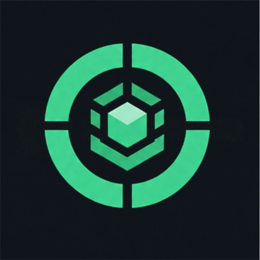
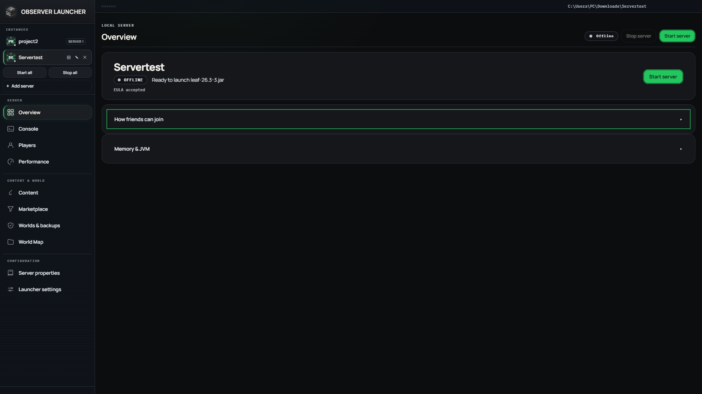
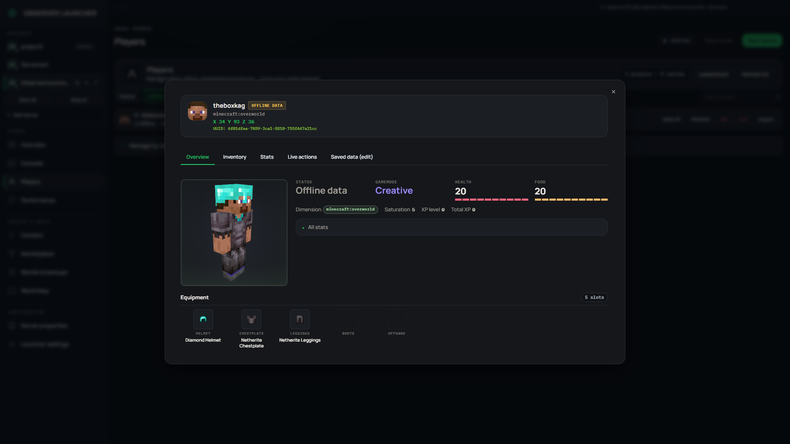
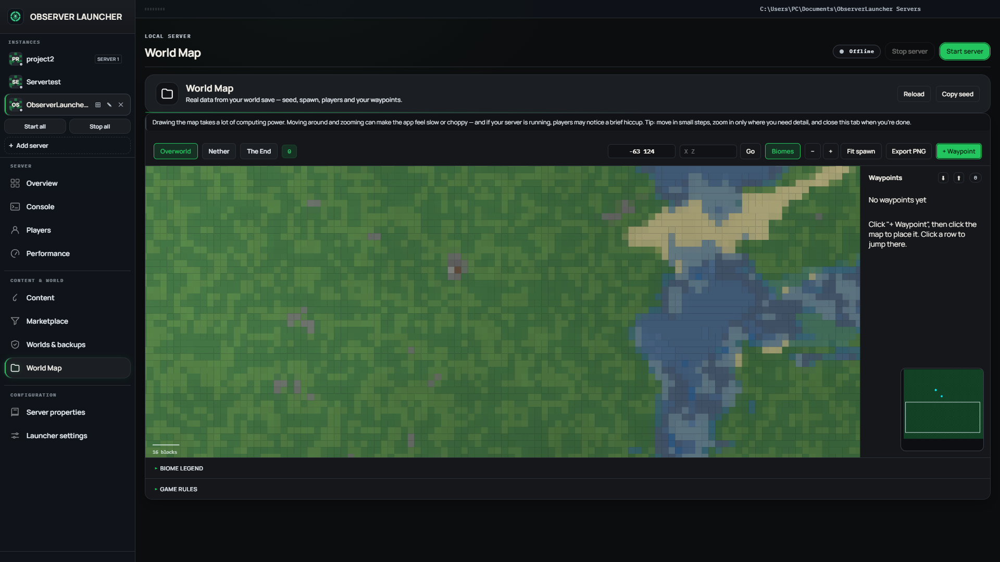

<div align="center">



# ObserverLauncher

**Host your own Minecraft: Java Edition server on Windows or Linux.**  
No terminal, no monthly cloud bills, no accounts. Pick a folder, select a version, and press Start.

[](https://github.com/Kag4286/ObserverLauncher/releases/latest)
[](https://github.com/Kag4286/ObserverLauncher/actions/workflows/test.yml)
[](https://github.com/Kag4286/ObserverLauncher/pulse)
[](LICENSE)
[](https://github.com/Kag4286/ObserverLauncher/releases/latest)
<br>
[](https://github.com/Kag4286/ObserverLauncher)
[](https://github.com/Kag4286/ObserverLauncher)
[](https://github.com/Kag4286/ObserverLauncher#mcp--ai-integration)
[](https://github.com/Kag4286/ObserverLauncher)
[](CONTRIBUTING.md)

[Releases](https://github.com/Kag4286/ObserverLauncher/releases/latest) &nbsp;·&nbsp; [Changelog](CHANGELOG.md) &nbsp;·&nbsp; [Contributing](CONTRIBUTING.md) &nbsp;·&nbsp; [Documentation](docs/)



</div>

---

## What is ObserverLauncher?

ObserverLauncher is a **server hosting application** designed to run on your local machine. It handles the setup that usually requires terminal commands and wikis: downloading server jars, matching the required Java version, configuring network tunnels, and taking safe world backups.

Everything runs locally on your PC. There are no proprietary accounts, no paid tiers, and zero telemetry.

---

## Quick Start

1. **Download & Install:** Grab the installer for Windows (`.exe`) or Linux (`.AppImage`) from [Releases](https://github.com/Kag4286/ObserverLauncher/releases/latest).
2. **Create Server:** Click **Create new server**, pick a server software (Paper, Fabric, Forge, Purpur, Vanilla, etc.), and select your Minecraft version.
3. **Start:** Click **Start**. The app checks your Java runtime, accepts the EULA, and launches the server.
4. **Invite Friends:** Share your local IP if on the same network, or click **Share to internet** (built-in Playit.gg integration) for an instant public address without router port forwarding.

---

## Key Features

### For Everyday Server Hosts

- **One-Click Server Setup:** Supports Paper, Purpur, Leaf, Folia, Fabric, Forge, NeoForge, Spigot, Vanilla, and Velocity. New versions appear automatically without app updates.
- **Java Auto-Detection:** Automatically matches your server's Minecraft version with the required Java runtime (Java 8, 17, 21, or 25) and offers to install it if missing.
- **Player Inspector & 3D Skins:** View connected and offline players, examine full inventories and equipment with real 2D item textures, inspect enchantments and durability, and preview rotatable 3D player skins.
- **Integrated Marketplace:** Search and install mods, plugins, and datapacks directly from Modrinth, Hangar, and SpigotMC with active loader compatibility checks and update alerts.
- **Safe World Backups:** Create ZIP snapshots of your worlds on demand or on a daily schedule. Worlds are temporarily paused (`save-off`) during archive creation to prevent corruption.
- **Interactive World Map:** View your explored chunks, terrain elevation, surface biomes, and waypoints directly from world save files.
- **Crash Recovery & Diagnostics:** Automatic crash report analysis with plain-English suggestions and rollback guards if a newly installed mod crashes the server.

<p align="center">
  
  &nbsp;
  
</p>

---

## Advanced Capabilities

ObserverLauncher also provides tools for experienced server operators and developers:

- **Multi-Instance Management:** Run several servers simultaneously. Each instance maintains isolated folders, Java runtimes, ports, schedules, and tunnels.
- **CLI Mode (`observer`):** Full headless command-line interface for scripting and server environments without a desktop:
  ```bash
  observer status
  observer start --instance survival-server
  observer players
  observer install luckperms
  ```
- **Model Context Protocol (MCP):** Acts as an MCP server allowing AI coding assistants and agents to monitor metrics, diagnose crashes, and safely manage the server via structured tool calls.
- **Docker Export & Headless:** Generate standard `docker-compose.yml` configurations directly from your instance settings to deploy anywhere.
- **Bedrock Crossplay:** Automatically detects Geyser and Floodgate, validates network configurations, and provides one-click compatibility fixes.
- **Prometheus Metrics:** Exposes live server TPS, MSPT, CPU, and memory stats via a local `/metrics` endpoint.

---

## Supported Server Software

| Software | Mod/Plugin Support | Live TPS / MSPT |
|---|---|---|
| **Paper / Purpur / Leaf / Folia** | Bukkit / Spigot / Paper plugins | Yes |
| **Fabric / Quilt** | Fabric mods | Player count |
| **Forge / NeoForge** | Forge / NeoForge mods | Yes |
| **Vanilla** | Datapacks only | Player count |
| **Velocity** | Proxy plugins | N/A (Proxy) |
| **Spigot** | Spigot plugins | Via config |

---

## System Requirements

- **Operating System:** Windows 10/11 (64-bit) or modern 64-bit Linux distribution.
- **Memory:** 4 GB RAM minimum (8 GB+ recommended for modded servers).
- **Disk:** ~1 GB for launcher and dependencies; additional space for world saves.
- **Java:** Any Java 8–25 runtime. The app detects existing installations and can automatically download OpenJDK runtimes.

---

## Building from Source

ObserverLauncher is built with Electron and Node.js. It adheres to a zero-dependency philosophy for core save data parsing (NBT, Region ANVIL files, and zip extraction are implemented cleanly without heavy third-party native binaries).

```bash
# Clone the repository
git clone https://github.com/Kag4286/ObserverLauncher.git
cd ObserverLauncher

# Install dependencies
npm install

# Run the app in development mode
npm start

# Run unit and integration tests (150 test suites)
npm test

# Run end-to-end tests
npm run test:e2e

# Build production installers
npm run build:win      # Windows installer (.exe)
npm run build:linux    # Linux AppImage
```

---

## Privacy & Security

ObserverLauncher operates 100% locally on your machine.
- **No telemetry, analytics, or tracking.**
- **No required logins or accounts.**
- All downloads (server jars, plugins, Java builds, and textures) come directly from official public APIs and mirrors.
- Minecraft assets and vanilla textures are never bundled into the installer, strictly respecting Mojang's EULA.

---

## License

ObserverLauncher is licensed under the [Apache-2.0 License](LICENSE).  
Minecraft is a trademark of Mojang Synergies AB. ObserverLauncher is an independent open-source project and is not affiliated with Mojang or Microsoft.
