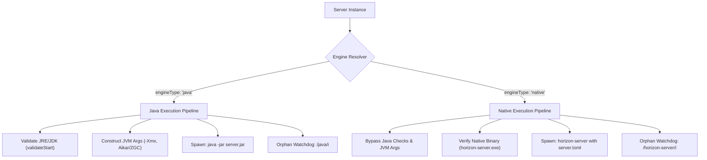
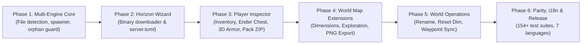

# Development Plan: ObserverLauncher v7.0.0Z
## "The Multi-Engine Era & Deep World Tooling"

> **Status:** APPROVED FOR PLANNING (2026-10-30).  
> **Target Release:** `v7.0.0Z`  
> **Deferred to v7.1.0:** Tracks 3, 4, and 5 (Content Bulk Updates & Conflicts, Spark Profiler & Cloud Backups, Headless REST & Event Hooks).  
> **Primary Focus for v7.0.0Z:**
> 1. **Track 1:** **Horizon Dedicated Server** (Rust Native Minecraft 26.3) & **Multi-Engine Core Architecture**.
> 2. **Track 2:** **Player & World Management Deepening** (Full Visual Inventory & Ender Chest, Armor on 3D Model, Resource Pack ZIP Overrides, Nether/End Dimensions, PNG Map Export, World Operations, Waypoint Sync).

---

## 1. Technical Evaluation: Horizon Dedicated Server (`horizon-rust/horizon`)

### 1.1 Overview & Architecture
- **What it is:** A clean-room re-implementation of Minecraft: Java Edition (specifically targeted at the latest **26.3** release) written entirely from scratch in **Rust**.
- **Dedicated Server Execution (`horizon-server`):** Standalone compiled native binary (`horizon-server.exe` on Windows, `horizon-server` on Linux/macOS).
- **Zero JVM Dependencies:** Completely independent of Java/JVM. Requires no JRE/JDK installation, contains no `.jar` files, and ignores JVM flags (`-Xms`, `-Xmx`, GC tuning flags).
- **Vanilla Protocol Compatibility:** Standard Minecraft: Java Edition 26.3 clients can join a Horizon dedicated server seamlessly over standard TCP without needing client mods or specialized third-party launchers.
- **Configuration Engine:** Uses a structured, typed `server.toml` file, while automatically synchronizing and exposing a vanilla-compatible `server.properties` mirror.

### 1.2 Key Strengths (Why the Community Requests It)
1. **Ultra-Low Memory Footprint:**
   - Idles at **~100MB – 300MB RAM** (compared to 1.5GB – 3.0GB for vanilla Paper/Fabric).
   - Under active player load, operates smoothly within **~600MB RAM**.
2. **Elimination of Garbage Collection Lag Spikes:**
   - Rust's memory model eliminates Stop-The-World (STW) GC pauses, providing exceptionally smooth TPS and MSPT stability.
3. **Sub-Second Startup:** Server boots in under 1 second.
4. **Viable for Low-Spec Hardware / Budget VPS:** Enables hosting full vanilla 26.3 worlds on budget 1GB RAM virtual servers.

### 1.3 Trade-offs & Strategic Positioning
- **No Java Mod / Plugin Compatibility:** Does NOT run Spigot/Paper `.jar` plugins or Fabric/Forge `.jar` mods. Supports vanilla Datapacks and native Horizon Rust crates.
- **Single Minecraft Version:** Targeted specifically at Minecraft 26.3.
- **Verdict:** **HIGHLY RECOMMENDED FOR INTEGRATION.** OBS will become the first mainstream desktop server manager to provide first-class support for Native Rust Minecraft servers alongside traditional Java loaders. Horizon will be integrated as:  
  `Software: Horizon (Rust Native - MC 26.3) [Experimental]`.

---

## 2. Multi-Engine Architecture Shift (Track 1)

Historically, OBS implicitly assumed every server runs through a Java runtime (`ctx.javaInfo` + `server.jar` + JVM args). v7.0.0Z formalizes the engine abstraction into two distinct execution pathways:

---

## 3. Work Breakdown: v7.0.0Z Core Tracks

### Track 1: Horizon Native Engine & Multi-Engine Core

#### 1.1 Engine Polymorphism & File Detection
- **`src/main/server-files.js` & `server-compat.js`**:
  - Update `detectSoftware(info)`:
    - If `horizon-server.exe` (Windows) or `horizon-server` (POSIX) exists, or if `server.toml` is present without any runnable `.jar`, identify software as `'horizon'` and set `engineType: 'native'`.
  - Maintain `engineType: 'java'` as default for all existing loaders (Vanilla, Paper, Purpur, Fabric, Forge, NeoForge, Mohist, etc.).
  - Implement bidirectional synchronization between `server.toml` (sections `[server]`, `[engine]`, `[backups]`, `[panel]`, `[properties]`) and standard `server.properties` so the existing Properties tab functions seamlessly.

#### 1.2 Process Lifecycle & Command Routing
- **`src/main/server-lifecycle.js`**:
  - In `startServerInternal()`:
    - If `engineType === 'native'`:
      - Bypass `validateStart()` (no Java runtime required on the host system).
      - Bypass JVM argument compilation (`buildLaunchArgs()`).
      - Check execution permissions on Linux/macOS (`chmod +x`).
      - Spawn native binary directly:
        `spawn(binaryPath, args, { cwd: serverPath, stdio: ['pipe', 'pipe', 'pipe'] })`.
  - Stdin/Stdout and console interaction:
    - Pipe standard I/O for real-time console streaming and command dispatch.
    - Collect live CPU & RSS memory metrics via existing `platform.getProcessInfo(pid)`.
    - Support auto-restart logic on unexpected exit codes.

#### 1.3 Orphan Process Guard
- **`src/main/orphan.js`**:
  - Update `classifyOrphan()` to recognize Horizon processes:
    `const isServerProcess = /java/i.test(name) || /horizon-server/i.test(name);`
  - Prevents running Horizon servers from being misclassified as foreign processes (`tier 3: forget`) if OBS exits or crashes unexpectedly.

#### 1.4 Downloader & New Server Wizard Integration
- **`src/main/wizard.js`**:
  - Add "Horizon (Rust Native - MC 26.3) [Experimental]" to software selection options.
  - Implement GitHub Releases fetcher for `horizon-rust/horizon`:
    - Auto-detect platform: `horizon-server-windows-x86_64.zip` vs `horizon-server-linux-x86_64.tar.gz`.
    - Download, extract binary, verify integrity, write default `server.toml`, and accept EULA.

#### 1.5 Adaptive UI
- **`src/renderer/` (Overview, Settings, Content)**:
  - When active instance is Horizon:
    - Hide or disable Java runtime selector, Java version badge, and JVM preset chips (Aikar, ZGC).
    - Display dedicated "Rust Native Engine" status pill in the Overview header.
    - In Content tab: Show an informative guide badge clarifying that Horizon supports Datapacks and native Horizon crates instead of Java `.jar` mods.

---

### Track 2: Player & World Management Deepening (Deferred Backlog)

#### 2.1 Visual Inventory, Ender Chest & Armor on 3D Model (B1b & B1c)
- **`src/renderer/js/03-players.js` & `03b-player-3d.js`**:
  - Implement full visual inventory grids:
    - Main Inventory (27 slots) + Hotbar (9 slots) + Off-hand slot.
    - Ender Chest (27 slots) with interactive search and slot counts.
  - Utilize `tex://` protocol to fetch item icons for all vanilla 26.x/1.21.x items.
  - Add interactive item tooltips displaying item ID, display name, quantity, enchantment levels, potion lore, and remaining durability bar.
  - In `03b-player-3d.js`: Render worn armor geometry (helmet, chestplate, leggings, boots) directly over the WebGL 3D player skin model.

#### 2.2 Custom Resource Pack Selector (B1d)
- **`src/main/textures.js` & `src/renderer/js/03-players.js`**:
  - Allow user to select a local `.zip` Resource Pack in Settings / Player Inspector.
  - Extract and cache item/block textures to a local instance cache directory (`cache/textures/pack/`).
  - Override `tex://` image resolution so custom textures appear in the 3D model, inventory grid, and world preview, falling back to vanilla textures when missing.

#### 2.3 World Map Extensions (B3)
- **`src/main/worldmap.js` & `src/renderer/js/02-worldmap.js`**:
  - **World Map Architecture:** High-speed top-down explored chunk and biome rendering across Overworld, Nether, and End dimensions. (Note: Cave Mode slice feature was evaluated and cleanly removed per user directive to prioritize rock-solid engine performance and clean toolbar design).
  - **Dimension Switcher Tabs:** Direct UI toggles for:
    - `Overworld` (`region/`)
    - `The Nether` (`DIM-1/region/`)
    - `The End` (`DIM1/region/`)
  - **Entity & Waypoint Markers:** Render interactive marker pins on top of the world map canvas showing real-time player locations, custom waypoints, and world spawn.
  - **High-Resolution PNG Map Export:** One-click button to render and save the full explored map canvas as a high-resolution PNG image file.

#### 2.4 Safe World Operations (B4)
- **`src/main/server-files.js` & `src/renderer/js/04-worlds.js`**:
  - **Rename World:** Safely update `level.dat` LevelName, folder name, and `server.properties` `level-name` with collision checks.
  - **Display Seed Viewer/Editor:** Read and safely edit world seed inside `level.dat` using `prismarine-nbt`.
  - **Single-Dimension Reset/Purge:** Safe deletion of individual dimension folders (`DIM-1` or `DIM1`) with automatic pre-operation backup confirmation.
  - **Inter-Instance World Clone / Transfer:** Copy or migrate a complete world folder cleanly between configured instances.

#### 2.5 Waypoint Synchronization (B5)
- **`src/main/worldmap.js` & `src/renderer/js/02-worldmap.js`**:
  - Support bidirectional waypoint import and export for popular map mods:
    - **Xaero's Minimap** (`XaeroWaypoints/` text format)
    - **JourneyMap** (`journeymap/data/` JSON format)
  - Allow sharing and synchronizing waypoints across different instances.

---

## 4. Deferred Roadmap: v7.1.0 Tracking

The following tracks have been moved to **v7.1.0** to ensure v7.0.0Z delivers unmatched quality on Horizon and World/Player tooling:

| Deferred Track | Key Features | Scheduled Version |
| :--- | :--- | :--- |
| **Track 3: Content Depth** | Bulk updates with automatic rollback (C2), Visual Conflict Detector GUI (C3), LuckPerms visual permission editor (C4). | `v7.1.0` |
| **Track 4: Observability & Cloud** | Spark Profiler deep integration (D5), Automated Cloud Backups to WebDAV / S3 / Rclone (F2). | `v7.1.0` |
| **Track 5: Developer Surface & Hardening** | Transactional Modpack Installer (H1), Themed Delete Dialog (H3), Three-way Update Policy (H4), Extended CLI commands & REST Event Hooks (I1, I3, I4). | `v7.1.0` |

---

## 5. Phased Implementation Roadmap for v7.0.0Z

### Phase Details:
1. **Phase 1: Multi-Engine Core & Lifecycle Refactoring**
   - Implement `engineType` resolution in `server-files.js`.
   - Update `server-lifecycle.js` to spawn and manage `horizon-server`.
   - Extend `orphan.js` process inspection.
2. **Phase 2: Horizon Downloader & Configuration Engine**
   - Build GitHub Releases asset downloader for Horizon in `wizard.js`.
   - Implement `server.toml` synchronization and properties bridge.
   - Implement Adaptive UI rules for Native vs Java instances.
3. **Phase 3: Visual Player Tooling & Resource Packs**
   - Implement 9x3 Inventory & Ender Chest grids in `03-players.js`.
   - Implement 3D armor overlay rendering in `03b-player-3d.js`.
   - Implement Resource Pack ZIP selector and texture override cache.
4. **Phase 4: Advanced World Map Features**
   - Streamline World Map toolbar with high-performance dimension navigation and PNG export.
   - Add Nether & The End dimension selectors in `worldmap.js`.
   - Implement high-res PNG map export.
5. **Phase 5: World Operations & Waypoint Importers**
   - Implement World Rename, Display Seed, Dimension Deletion, and Instance Clone.
   - Implement Xaero's & JourneyMap waypoint parser and sync modal.
6. **Phase 6: Polish, Accessibility, i18n & Test Suite Verification**
   - Full translation coverage across all 7 supported languages (`en`, `vi`, `es`, `pt-BR`, `de`, `ru`, `zh-CN`).
   - Maintain 100% test pass rate across all unit and architectural tests (`tests/run.js`).

---

## 6. Inviolable Design Gates & Contracts

1. **No Mojang Assets Bundled:** All game icons and textures must resolve dynamically at runtime via `tex://` or local user-provided Resource Pack archives.
2. **Strict File Safety & Automatic Backups:** Any operation that modifies world files, deletes dimensions, or alters configuration must perform an atomic backup first.
3. **Pure Vanilla JS / CSS Stack:** No heavy frontend frameworks (React, Vue, Tailwind, etc.) or bundlers introduced.
4. **Zero Regressions for Java Servers:** Paper, Fabric, Forge, Purpur, and vanilla Java instances must retain 100% stability and identical workflows.
5. **Architectural Isolation:** Native Engine logic must be modularized cleanly without leaking into Java-specific lifecycle handlers.
